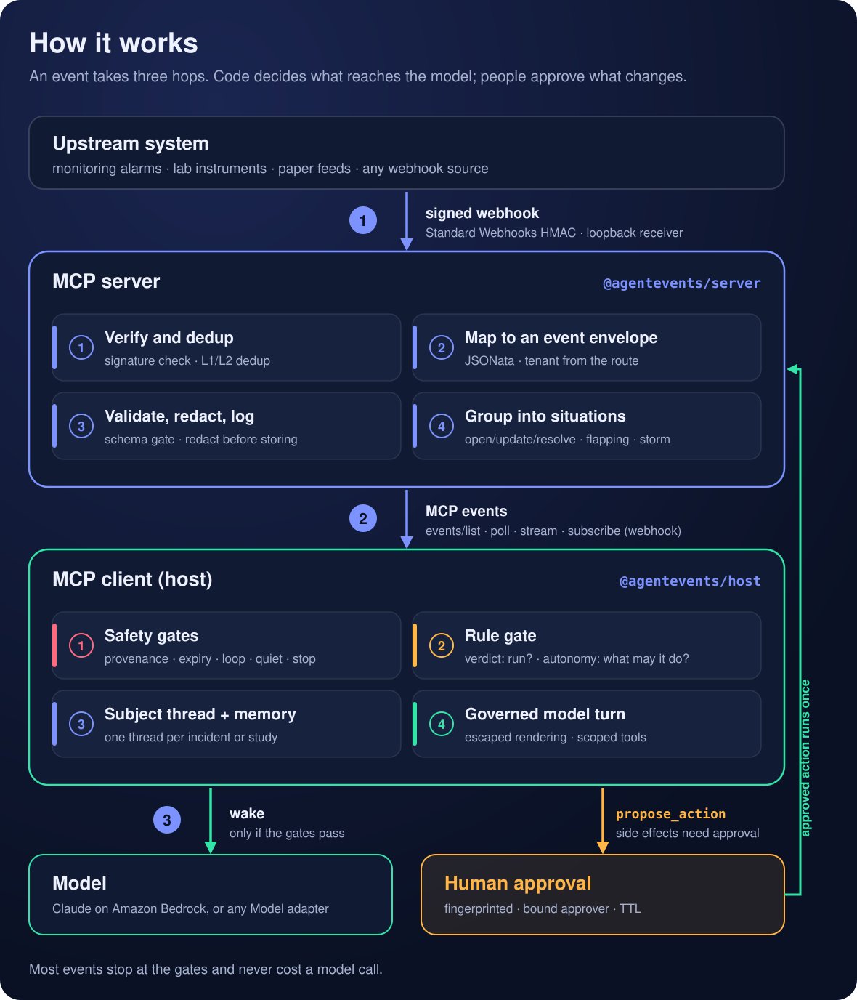

# Event Agent MCP SDK

> This is sample code, for non-production usage. Work with your security and legal teams to meet your
> organizational requirements before deployment.

A TypeScript SDK for event-driven AI agents on the [Model Context Protocol](https://modelcontextprotocol.io) (MCP).
It builds on the proposed MCP events extension
([SEP-3415](https://github.com/modelcontextprotocol/modelcontextprotocol/pull/3415), `io.modelcontextprotocol/events`).
On top of it, the SDK adds what an agent needs before it can safely act on events:
- deterministic gates that decide which events reach the model;
- situations that group noisy signals;
- human-approved actions;
- versioned rules;
- conversation threads that keep their context.

https://github.com/user-attachments/assets/ee4509e3-3e2f-4333-b010-f29fa6675317

*Watch the 6-minute overview ([MP4, 12 MB](docs/media/event-agent-mcp-sdk.mp4)): the problem, the SDK design, and two use cases.*

## The problem

MCP today is request/response. An agent only learns what's happening when somebody asks it. Events that matter
(an alarm fires, a data stream drifts, a paper is published) never reach it until the next question.

The proposed MCP events extension fixes transport: servers can deliver events to clients by poll, stream, or a
signed webhook. But it stops at the client. It leaves you to decide:

- **Which events should wake the model?** Sending every event to an LLM makes cost and noise explode.
- **How should untrusted event data be shown to the model?** Event text is attacker-controllable input.
- **Whose authority does the agent act with,** and who approves a change to production?
- **How is context kept** across hundreds of related events?

Every team ends up hand-writing a polling loop, a webhook handler, a filter, and a scheduler for every server it connects.

## What this SDK provides

The SDK implements the **Event-Driven MCP pattern**: the MCP events transport plus five companion extensions
(normative design in [docs/spec.md](docs/spec.md)). It is not a new protocol. Companion data rides in `_meta`, so
peers that only support the base extension still interoperate.

| Extension | What it gives you |
|---|---|
| **E1 Event contract** | A CloudEvents envelope with deterministic IDs, a schema registry, fields marked untrusted, redaction before persistence, and a tenant taken from the delivery path, never from the payload |
| **E2 Situations** | Many raw signals become one situation with open, update and resolve transitions, plus flapping and storm detection |
| **E3 Activation** | A gate pipeline that runs in code before any model is involved. Mandatory safety gates (provenance, expiry, loop prevention, quiet hours, dedup, emergency stop) come first, then your rules. Two separate dials: the **verdict** (`drop`, `store`, `digest`, `wake`, `decide`, `escalate`) says whether the model runs, and the **autonomy** (`notify`, `investigate`, `propose`, `act`) says what it may do |
| **E4 Actions** | Reversibility tiers, proposals with fingerprints and a bound approver, idempotency keys, and a write ledger that handles an `outcome_unknown` result |
| **E5 Rules** | Plain-language requests become structured rules. Each rule is validated, backtested against past events, approved according to its risk tier, deployed in shadow or live mode, and can be rolled back. Rules live in an append-only log |

## Why it matters

- **You pay the model only for what matters.** Deciding what reaches the model is code, not a prompt. In
  [`scripts/bench-gates.ts`](scripts/bench-gates.ts), 20,000 events against 300 rules took about 0.05 ms each
  (p50), and with a 10% rule match rate, 9 in 10 events never reached a model.
- **Agents hear the world as it changes.** One thread per subject (an incident, a study) builds context turn by
  turn, and follow-up questions run with that context loaded.
- **People stay in control.** Limits downgrade autonomy and record the downgrade; they never fail silently. Side effects
  need an approved proposal, or an explicit allowlist for safe, reversible tools. Event-triggered sessions never
  see rule or configuration tools, and rules cannot remove safety gates.
- **It's safe with untrusted input.** Event text is escaped and rendered with a per-prompt nonce. Prompt injection in
  event data is withheld and taints the turn, and an action target must come from a clean read-tool result,
  not from event text.

## How it works



An event takes three hops:

1. **Upstream to server.** A webhook receiver verifies the signature, a JSONata mapping builds the event envelope,
   and the server validates, redacts, deduplicates, logs, and groups events into situations.
2. **Server to client.** Events are delivered over the MCP events methods: `events/list`, `events/poll`,
   `events/stream`, and opt-in `events/subscribe` webhooks (HTTPS only, DNS pinned at delivery, no redirects,
   secret rotation with overlap).
3. **Client to model.** The host deduplicates, runs the gate pipeline, notifies humans, and queues the event to
   that subject's thread. It then runs a model turn with escaped rendering, untrusted-field screening, and tools
   scoped to the granted autonomy.

## Using it

On the server, declare events next to your tools:

```ts
const events = new EventServer({ name: 'ops', version: '1.0.0', sessionTenant: () => tenantid });
events
  .defineEvent(alarmSituation)       // an event type with its schema and hints
  .addMapping(monitoringMapping)     // upstream payload → event envelope (JSONata)
  .addSituation(situationConfig);    // raw alarms → one situation per service
```

On the client, attach a host and say what wakes the model:

```ts
const host = new EventHost({ model, owner, rules: () => rules.live(), decisions });
await host.attach(opsClient, { names: [alarmSituation.type], mode: 'stream' });
```

A rule is data, not a prompt. The shared vocabularies (`Verdict`, `Autonomy`, `Severity`, `Transition`,
`FilterLanguage` and others) are enum objects, so code never spells their values as string literals:

```ts
import { Autonomy, FilterLanguage, Severity, Transition, Verdict } from '@agentevents/contract';

const rule: Rule = {
  id: 'prod-high-propose', version: 1, priority: 20,
  types: ['com.example.ops.alarm.v1'],
  filter: { language: FilterLanguage.EbPattern, expression: {
    'data.env': ['prod'],
    'situation.transition': [Transition.Open],
    'situation.severity': [Severity.High, Severity.Critical] } },
  verdict: Verdict.Wake,        // the model runs
  autonomy: Autonomy.Propose,   // it may propose a fix; a human approves
};
```

## Quick start

Requires Node 22 (see `.nvmrc`) and pnpm.

```sh
pnpm install
pnpm verify            # typecheck + all tests (offline; no model or AWS calls)
pnpm demo              # cloud operations walkthrough with a scripted model
pnpm demo:research     # research walkthrough: ~6,000 data points, threads, follow-ups
```

To run the demos with Claude on Amazon Bedrock (the recommended path, with AWS IAM, managed security and cost
controls), use AWS credentials that can invoke the model in your Region:

```sh
AGENTEVENTS_MODEL=bedrock pnpm demo
```

`AGENTEVENTS_MODEL=claude` uses the Claude API directly and is meant for local development. Tests always use the
scripted model.

## Examples

### Cloud operations: [`examples/cloudops-demo`](examples/cloudops-demo)

Pat is on call for an online shop's checkout platform. Pat configures the agent once, in plain words: "wake me
for high or critical production alarms and let the agent propose a fix; investigate anything else in prod; never
wake anyone for staging; give me one storm, not a page for each alarm". Each request becomes a rule that Pat
reviews and approves. Then:

1. A signed production alarm wakes the agent. It investigates with read-only tools and proposes a restart.
2. Redeliveries, forged signatures and schema-invalid payloads never reach the agent.
3. Staging alarms are stored, not woken on.
4. Prompt injection in alarm text is withheld and the turn is tainted. A target taken from event text is refused.
5. Pat approves. The restart runs once, and the recovery event is recognized as the agent's own action, so it doesn't page again.
6. Approval after the situation has resolved is refused as stale.
7. During an emergency stop, humans are still notified but the agent does not act.
8. An alarm storm becomes one thread and one turn.
9. A plain-language rule change goes through propose, backtest, approve and deploy.
10. `rules_explain` answers "why didn't the agent react?".

In the demo, 16 events lead to 5 agent turns.

### Research: [`examples/research-demo`](examples/research-demo)

Dr. Rivera runs four long-term studies, with instruments reporting around the clock and new papers published every
day. Dr. Rivera asks to be told when a study drifts (3 readings past 3σ within 10 minutes) and when a new paper is
highly relevant. Then:

- About 6,000 readings and paper alerts arrive. Exact re-sends and near-duplicates are removed.
- Only sustained drift and highly relevant papers pass the gates: 96 events, which become 3 model turns.
- One thread per study builds context: the drift, then a paper that may explain it, then word that the drift is continuing.
- Dr. Rivera's follow-up question ("is this consistent with last week's batch?") is answered from what the thread already holds.

## Packages

| Package | Role |
|---|---|
| [`@agentevents/contract`](packages/contract) | CloudEvents envelope, schema registry (`x-event` annotations, strict write and tolerant read), redaction, filters (`eb-pattern`, JSONata), JSONata mappings with test vectors, the escaping renderer, Standard Webhooks, and the MCP events wire shapes |
| [`@agentevents/core`](packages/core) | No MCP or LLM dependency. Store ports, the gate pipeline, mandatory safety gates, declarative rules with a threshold operator, the situation engine, deterministic replay and impact diffs |
| [`@agentevents/server`](packages/server) | `EventServer` wraps the official MCP TypeScript SDK's `McpServer`. Event declaration, mappings, situations, ingest, the MCP events methods, webhook delivery with an SSRF policy, and a loopback upstream webhook receiver |
| [`@agentevents/actions`](packages/actions) | Reversibility tiers, `defineAction` (idempotency keys, write ledger, `outcome_unknown`), and proposals with fingerprints, TTL, a bound approver, and stale-on-resolve |
| [`@agentevents/host`](packages/host) | `EventHost`: attach and subscribe (stream, poll, or webhook), gating, subject threads with `ThreadMemory`, mid-turn policy, coalescing, untrusted-input screening, scoped tools, approvals, `ask` follow-ups, and model adapters (`bedrockClaudeModel`, `claudeModel`, `scriptedModel`) |
| [`@agentevents/rules`](packages/rules) | `RuleStore` (propose, validate, backtest, risk tier, approve, shadow or live deploy, rollback) on an append-only `RuleLog`, and the `rules_*` MCP tools |
| [`@agentevents/store-dynamodb`](packages/store-dynamodb) | Amazon DynamoDB adapters for every store port on one table with TTL. Tests run against an in-process emulator on loopback and never call AWS |
| [`@agentevents/testkit`](packages/testkit) | `makeEvent`, a schema-driven fake data generator, and a mapping purity check |

There is no build step: each package exports `./src/index.ts`, and imports resolve through `tsconfig.json` paths.
`@agentevents/*` and the `org.agentevents` extension namespace are placeholder names, defined in one place
(`packages/contract/src/ns.ts`).

## Security defaults

- Network listeners bind to `127.0.0.1` by default.
- Webhook secrets come from your configuration; there is no default secret.
- Webhook delivery is HTTPS only, with DNS checked and pinned at delivery time, no redirects, and a rate limit per host. `allowLoopbackHttpForDev` exists for tests and demos only.
- `causationid` from an upstream payload is only used to suppress events, never to authorize anything.

## Status

Implemented and tested: everything in the package table. One end-to-end test restarts the app on the same
DynamoDB table and checks that rules, dedup state, the event log and decision records all survive.

Not built yet:

- **Thread memory** has no summarization or compaction for very long threads. A turn sees the last 40 entries.
- **Durable subscription state.** Webhook subscriptions and situation-engine state are in memory. After a restart, clients re-subscribe and open situations are rebuilt from new events.
- **Multiple writers per DynamoDB log.** Each log assumes one writer process.
- A Postgres adapter, CEL filters, an AsyncAPI emitter, and the `absence`, `sequence` and `correlation` operators.
- **Digest delivery.** Events are queued, but nothing flushes them yet.
- Webhook-receiver rate limits, sender allowlists, and per-subject crypto-shredding.

Known deviations from the proposed extension:

- Webhook secrets are chosen by the client (the server generates one only if the client omits it), and rotation happens by refreshing with a new secret.
- `notifications/events/heartbeat` is this SDK's name for heartbeats.
- The `bedrockClaudeModel` and `claudeModel` adapters are covered by offline tests with fake clients but have not been run against a live model from this repo. Confirm that the Bedrock model ID (`anthropic.claude-opus-5-5`) is available in your Region.

## Security

See [CONTRIBUTING](CONTRIBUTING.md#security-issue-notifications) for more information.

## License

This library is licensed under the MIT-0 License. See the LICENSE file.
